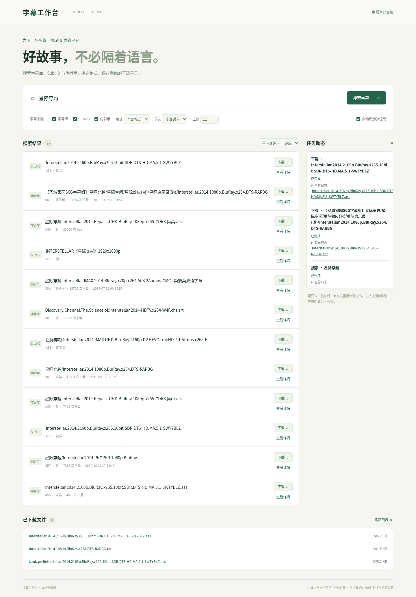

# Sub-Dog · 字幕工作台

Sub-Dog 是一款支持 Docker 部署的字幕搜索与下载工具，聚合字幕库、SubHD 和伪射手资源，通过浏览器即可查找和下载电影、剧集字幕，适合在个人服务器或 NAS 上使用。

## 项目功能

- **多来源聚合搜索**：一次搜索多个字幕站，统一展示结果和来源，方便比较和选择。
- **格式与语言筛选**：按字幕格式、语言筛选结果，快速找到需要的版本。
- **字幕详情查看**：查看格式、语言、评分、下载量、上传时间等信息。
- **网页下载管理**：在浏览器中发起下载、查看任务状态，并取回已保存的字幕文件。
- **验证码处理**：使用 [ppllocr](https://github.com/gitpetyr/ppllocr) 自动识别验证码，结果不可信时转为网页手动输入，支持换图或取消。
- **多任务管理**：支持连续提交搜索和下载任务，切换查看当前保留的搜索结果。
- **压缩包处理**：自动提取 ZIP 中的字幕文件；RAR、7z 保留原包，方便下载后自行解压。
- **数据持久化**：保存设置、Cookie 和下载文件，容器重启后仍可使用已保存的数据。
- **Docker 部署**：单容器，GitHub Actions 发布 amd64 / arm64 多架构镜像 `sunqz/sub-dog`，适合服务器和 NAS 部署。
- **适配电脑与手机**：通过浏览器访问，使用响应式界面完成搜索、验证码输入和文件下载。

## 统一字幕库与硬链接

把下载目录当作统一的字幕库，再用硬链接把字幕「放」到视频旁边，Jellyfin、Emby、Plex、Kodi 等播放器即可识别：

```
/volume1/data/
├── subtitles/                         ← 字幕库（DOWNLOAD_DIR）
│   └── <任务>/Interstellar.chs.srt
└── media/电影/星际穿越 (2014)/          ← 媒体目录（MEDIA_DIR）
    ├── Interstellar.2014.1080p.mkv
    └── Interstellar.2014.1080p.zh-CN.srt   ← 硬链接，按视频文件名 + 语言后缀命名
```

- **关联到媒体**：在「已下载文件」中点击字幕旁的「关联到媒体」，选择视频文件和语言后缀即可创建硬链接。手动用 `ln` 创建的硬链接也会被自动识别。
- **联动删除**：删除资源文件夹（连同其中的字幕硬链接）后，字幕库中对应的字幕进入倒计时，默认 30 秒后删除；倒计时内恢复链接或点击「保留」即可取消。从未关联过的字幕不会被删除。开关和延迟可在网页中设置。
- **前提**：字幕库与媒体目录在同一存储卷，且在 Docker 中挂载它们的**共同父目录**（如 `/volume1/data:/media-root`），并让 `PUID` / `PGID` 与媒体文件所有者一致，详见 [NAS 部署说明](deploy/nas/README.md)。
- **注意**：以「复制后删除」方式跨卷移动媒体文件夹时，链接数会暂时归 1，若移动时间超过延迟，字幕会被当作孤立文件删除；这种情况请调大延迟或临时关闭联动删除。同卷内的重命名、移动不受影响。

## 界面预览



## 使用方式

1. 输入电影或剧集名称，选择字幕来源、格式和语言。
2. 在搜索结果中查看详情，选择需要的字幕并发起下载。
3. 如遇验证码，按页面提示完成验证。
4. 在“已下载文件”中取回字幕。

字幕站的访问情况和资源可用性可能随网络环境、站点规则变化。SubHD 完整下载不可用时，可能回退保存预览内容，页面会提示核对格式和完整性。

## 部署

服务器直接拉取镜像（数据保存在同级 `./data` 目录）：

```sh
curl -O https://raw.githubusercontent.com/traceonx/sub-dog/recovery/claude-v0.3.0/deploy/docker-compose.yml
docker compose up -d
```

打开 `http://服务器IP:8082`。NAS 部署、字幕库与媒体目录挂载、更新与备份见 [NAS 部署说明](deploy/nas/README.md)。

从源码构建并在本机运行：

```sh
cp .env.example .env
docker compose up -d --build
```

推送到恢复分支时，GitHub Actions 依次执行 verify → build（amd64 / arm64 原生构建）→ push，发布 `sunqz/sub-dog:recovery`；`main` 使用 `latest`。需要在仓库 Secrets 中配置 `DOCKER_USERNAME` 与 `DOCKER_PASSWORD`。
